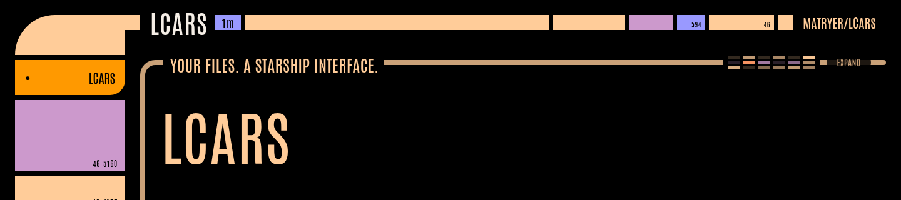
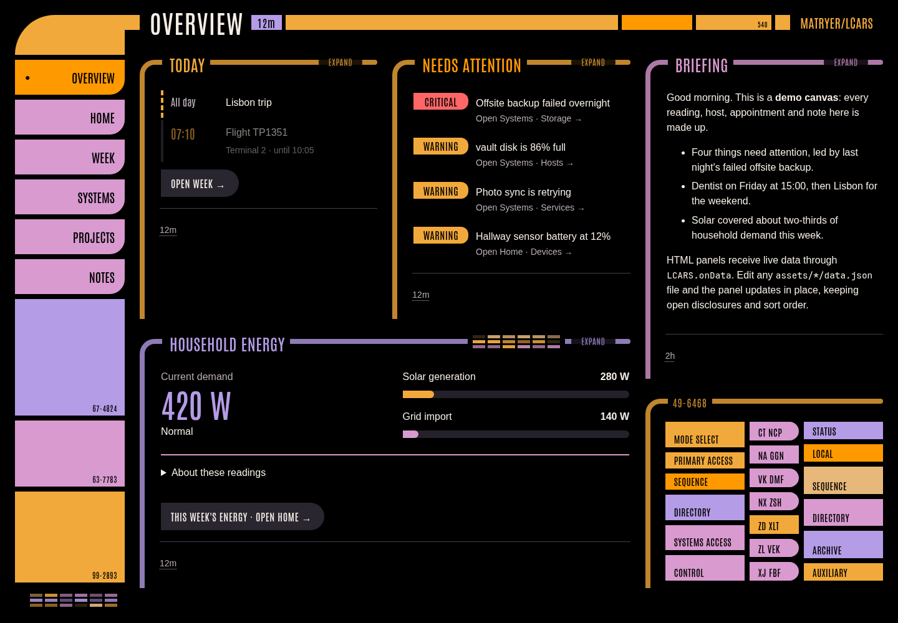
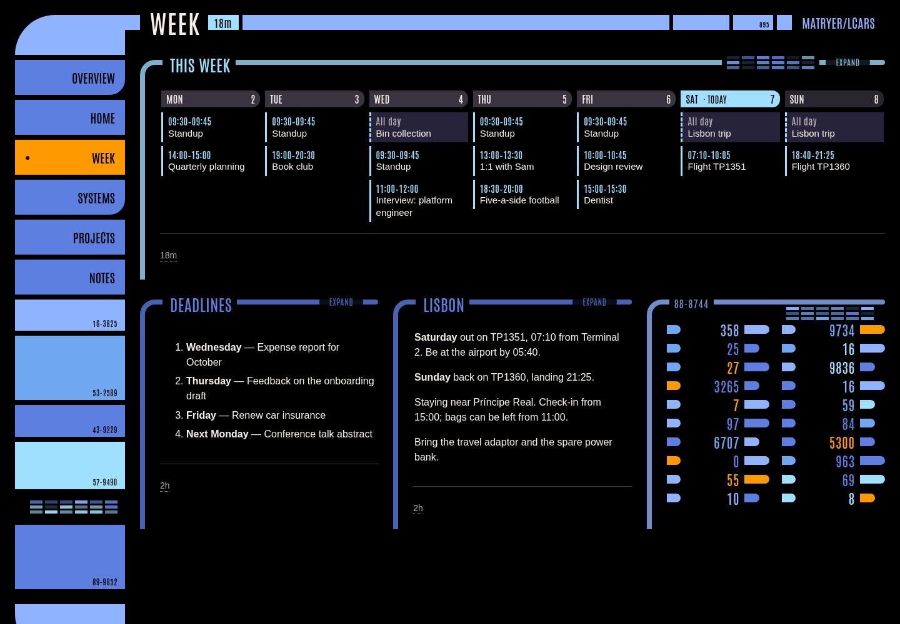
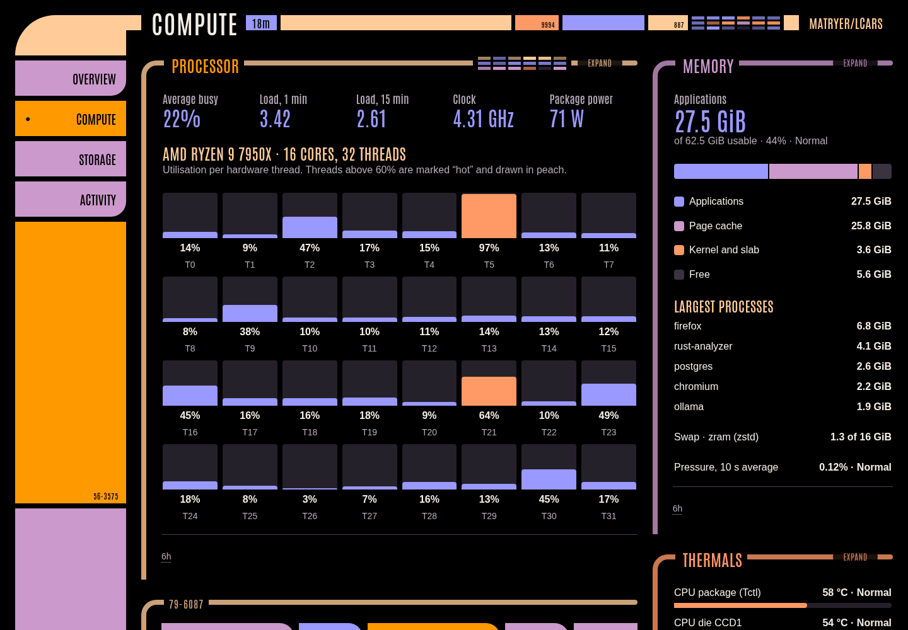

A personal canvas inspired by _Star Trek: The Next Generation_. Write Markdown, text, or HTML; LCARS turns it into a live dashboard with navigation, panel frames, and that familiar LCARS look. One Go binary, with no Node runtime needed to serve it.

## Try it

Install the pinned toolchain with `mise install`, then:

```sh
mise run build
./lcars serve --data ./examples/content
```

The server listens on port **8080**, on loopback by default. The example includes an overview, home dashboard, week planner, systems, projects, and notes. All example data is fictional.

## Desktop app

Open the same canvas in a native [Wails](https://v3.wails.io/) desktop window:

```sh
mise run desktop
./desktop/lcars-desktop --data ./examples/content
```

The desktop build requires your platform's native webview libraries. See the
[desktop guide](docs/desktop.md) for setup, default content locations, and Windows
build instructions.

## Examples

### At a glance

Your agenda, alerts, briefing, and household energy in one view.



### Plan your week

A responsive calendar alongside deadlines and travel notes. HTML and Markdown panels share the same canvas.



### Watch your machines

CPU, memory, temperatures, storage, processes, and network activity for a fictional workstation. Run it with `./lcars serve --data ./examples/machine/content`.



[Explore the machine example and more screenshots →](examples/machine/README.md)

## Make it yours

Start with an existing directory and add your content:

```text
content/
  overview/
    briefing.md
    energy.html
    assets/
      energy/
        data.json
  projects/
    garden/
      plan.md
```

```sh
./lcars serve --data ./content
```

- **Folders become sections.** Nested folders add sub-section tabs.
- **Files become panels.** Use `.md`, `.txt`, or `.html`; LCARS provides the frame.
- **Edits appear live.** HTML panels can receive `assets/{panel}/data.json` updates without losing sort order or open disclosures.
- **Scripts can supply data.** Opt in with `--run-scripts` to schedule adjacent Python, JavaScript, shell, or PowerShell producers.

For an agent-assisted canvas, print the bundled authoring skill with `./lcars skill`, or export it with `./lcars skill --out ./lcars-authoring`.

[Authoring guide](skills/lcars-authoring/references/guide.md) · [Portable skill](skills/lcars-authoring/SKILL.md) · [HTML starter](skills/lcars-authoring/assets/starter.html)

## Develop and capture

```sh
mise run test   # JavaScript tests, Go race tests, and vet
mise run fmt    # gofmt and Prettier
./lcars snapshot --data ./examples/content --out ./captures
```

Screenshot capture needs Chrome or Chromium. The server itself needs neither a browser nor Node.

For private hosting, keep LCARS behind an authenticated proxy. See the [reference](docs/reference.md) for deployment, scheduled scripts, capture options, publishing behavior, and releases. [Screenshot capture instructions](examples/screenshots/README.md) cover the images above.

## License

LCARS is licensed under the [MIT License](LICENSE). Antonio is included under the [SIL Open Font License](web/toolkit/fonts/OFL.txt).

---

Inspired by the LCARS designs of Michael and Denise Okuda and the production teams of _Star Trek: The Next Generation_. An independent implementation.
