# Machine stats example

A four-section LCARS canvas for **atlas**, a fictional Linux workstation. Every reading is a made-up but realistic fixture observed at 09:42 UTC on 7 November 2026. Nothing here is collected from a real machine.

The numbers tell one consistent story. The USB archive disk is 93% full. Because of that, last night's `backup-archive.service` failed with `ENOSPC`, and its 03:00 burst appears in the disk throughput chart. That one problem shows up in the vitals, the filesystems panel, the services log and the briefing. Everything else on the machine is Normal.

```sh
mise run build
./lcars validate --data ./examples/machine/content
./lcars serve --data ./examples/machine/content
```

## Screenshots

### Overview

Headline vitals, a Markdown briefing, and kernel counters accumulated since boot.

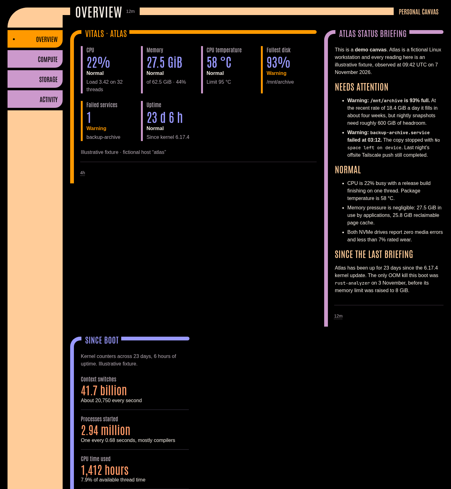

### Compute

Per-thread CPU load (a release build is pinning thread 5), the memory breakdown, sensors, fans and a 60-minute temperature chart.

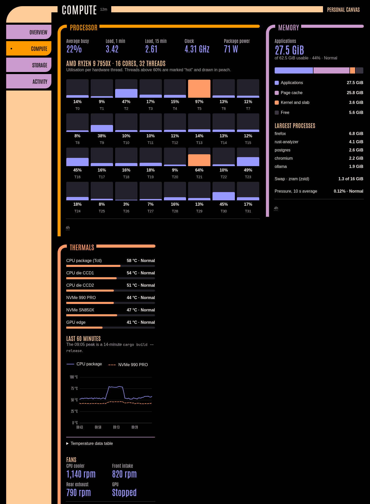

### Storage

Filesystem usage with warning thresholds and days until full, SMART health per drive, and 24 hours of disk throughput.

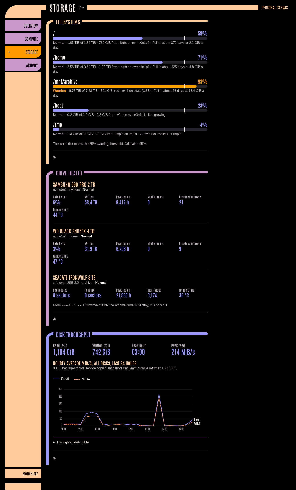

### Activity

A sortable process table, network interfaces with latency and 24-hour traffic, and failed systemd units and timers.

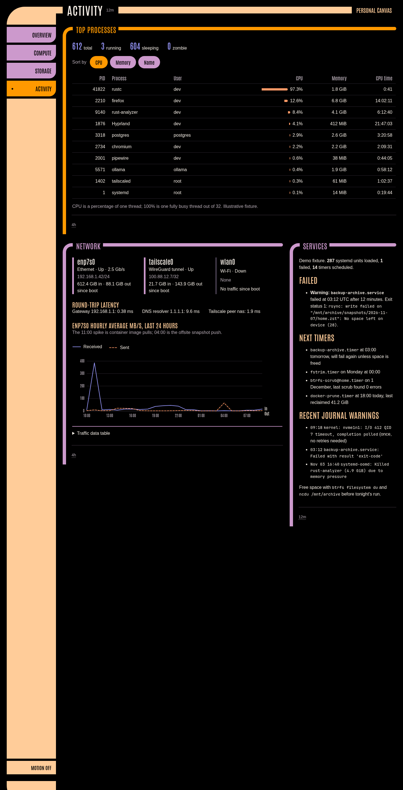

### Mobile

| Overview | Compute | Storage | Activity |
|---|---|---|---|
| 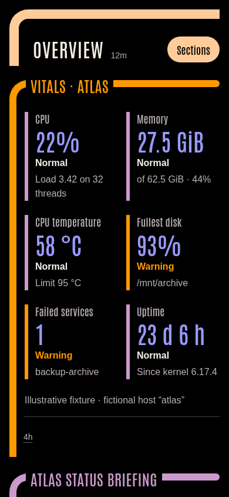 | 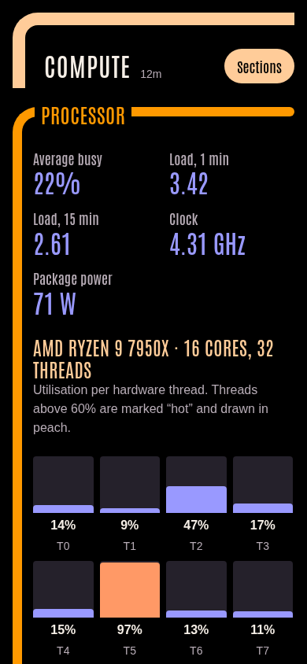 | 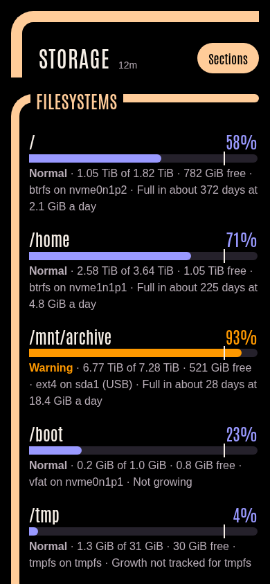 | 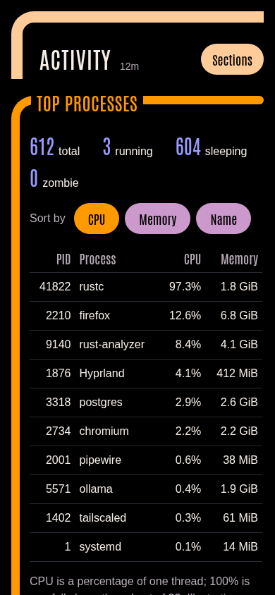 |

### Panel close-ups

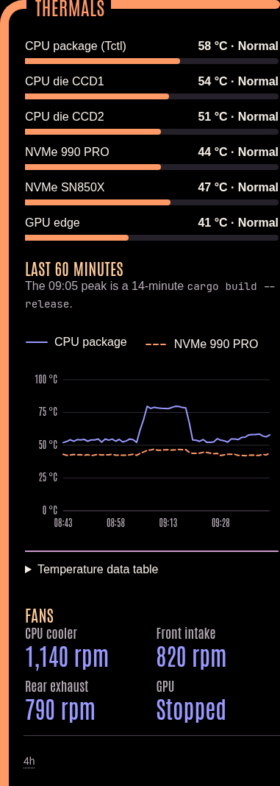
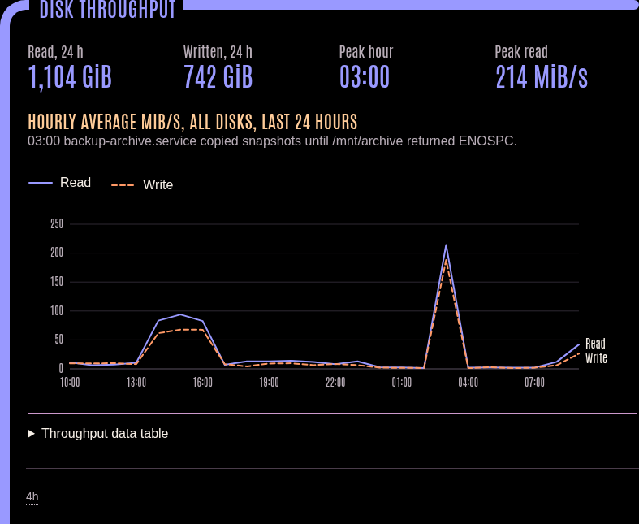
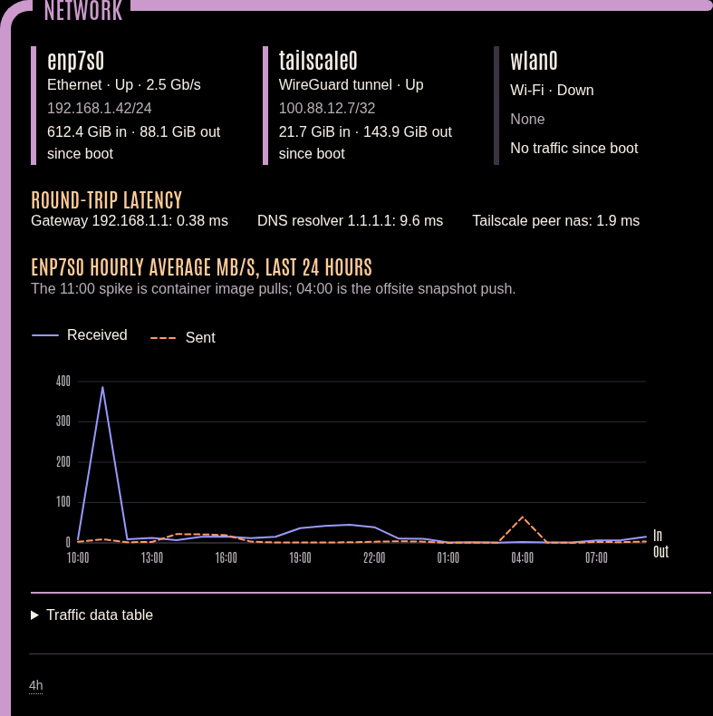
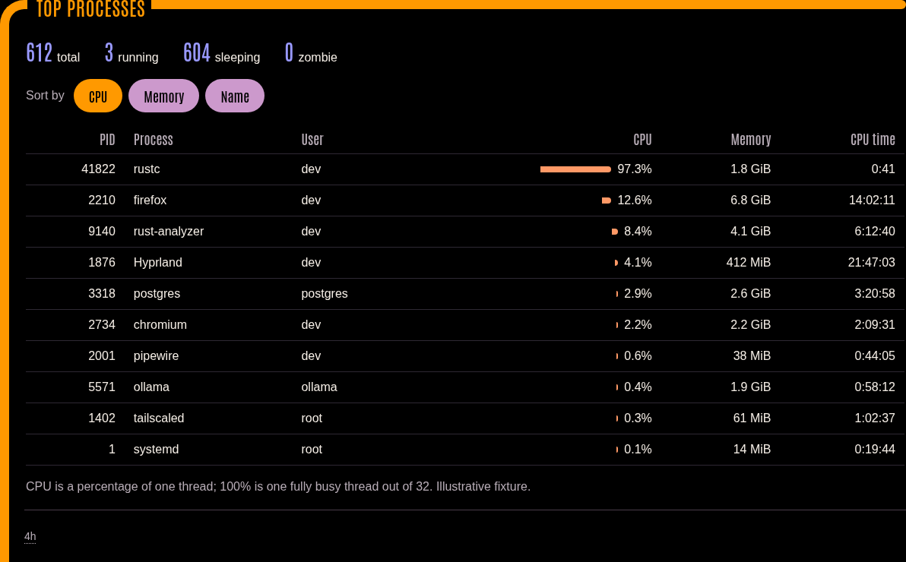

## Layout

```text
content/
  overview/   vitals.html, briefing.md, since-boot.html
  compute/    cpu.html, memory.html, thermals.html
  storage/    filesystems.html, drives.html, io.html
  activity/   processes.html, network.html, services.md
  */assets/{panel}/data.json   live data for each HTML panel
```

Each HTML panel draws its layout once and renders whatever `LCARS.onData` delivers. A collector would only need to rewrite the `data.json` files atomically to make this canvas live. The HTML would not change, and the sort order and open disclosures would survive each update. The charts are plain inline SVG. They redraw when their panel width changes, use one y-axis, tell series apart with dash patterns as well as colour, and each has a hover crosshair and a data-table disclosure.

## Regenerating screenshots

With the example served on a local port:

```sh
./lcars screenshot --url http://127.0.0.1:8080/s/storage --width 1440 --height 2380 --out examples/machine/screenshots/storage-desktop.png
./lcars screenshot --url http://127.0.0.1:8080/s/storage --width 390 --height 844 --out examples/machine/screenshots/storage-mobile.png
./lcars screenshot --url http://127.0.0.1:8080/s/storage --width 1440 --height 3200 --panel storage/io --out examples/machine/screenshots/panel-io.png
```

Desktop heights were chosen per section to fit the full page: overview 1560, compute 1960, storage 2380, activity 2820. Use a viewport tall enough that a `--panel` target is on screen. A panel below the fold currently captures with a blank interior. To check every section at all four standard widths, run `./lcars snapshot --data ./examples/machine/content --out ./captures`.
